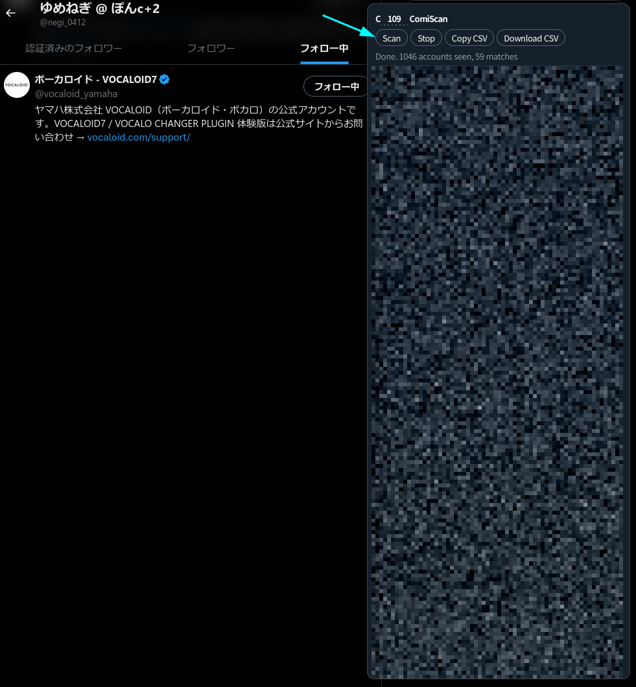
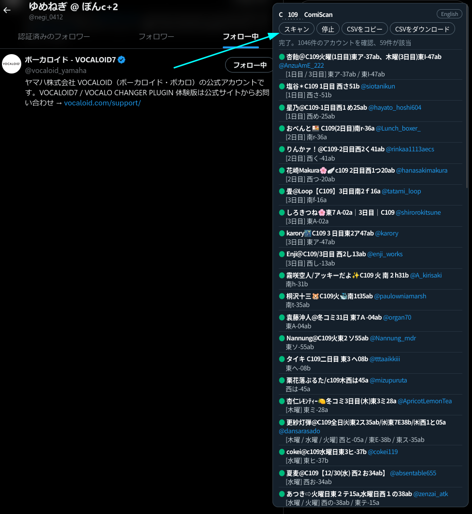

# ComiScan!
**English** | [日本語](#日本語)

## Table of Content
- [ComiScan!](#comiscan)
  - [Table of Content](#table-of-content)
  - [Description](#description)
  - [Installation](#installation)
  - [Usage](#usage)
- [日本語](#日本語)
  - [概要](#概要)
  - [インストール](#インストール)
  - [使い方](#使い方)

## Description
ComiScan is a Tampermonkey script that scrolls through your Twitter/X following page for artists who have announced they are participating Comiket by doing a bunch of regex checks. It then presents you with a list of them. Works pretty well!

## Installation
1. Install [Tampermonkey](https://www.tampermonkey.net/) browser plugin.
2. [Click here to install the script from the repo.](https://raw.githubusercontent.com/yumenegi/comiscan/main/comiscan.user.js)
3. This page should show, click "Install"

4. The script is now installed!

The panel follows your browser language by default. Use the **日本語 / English** button in the top-right corner of the panel to switch.

## Usage
1. Open your Twitter/X following page.

2. Click scan and wait!

---

# 日本語
[English](#comiscan) | **日本語**

## 概要
ComiScanは、X（旧Twitter）のフォロー一覧を自動でスクロールし、正規表現でプロフィールをチェックしてコミケ参加を告知しているアーティストを探すTampermonkeyスクリプトです。見つかったアーティストを一覧で表示します。けっこう使えます！

## インストール
1. ブラウザに[Tampermonkey](https://www.tampermonkey.net/)をインストールします。
2. [ここをクリックしてリポジトリからスクリプトをインストールします。](https://raw.githubusercontent.com/yumenegi/comiscan/main/comiscan.user.js)
3. 次のような画面が表示されるので、「インストール」をクリックします。

4. これでインストール完了です！

パネルの表示言語は、初期状態ではブラウザの言語設定に合わせます。パネル右上の **日本語 / English** ボタンで切り替えられます。

## 使い方
1. X のフォロー一覧ページを開きます。

2. 「スキャン」をクリックして待ちます！

