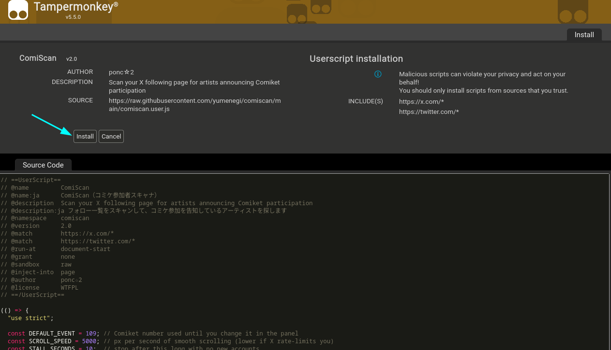
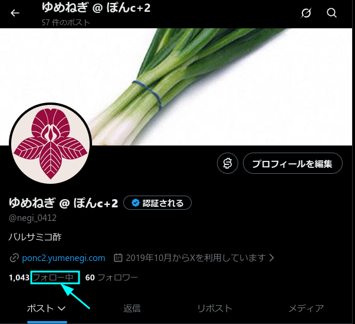

# ComiScan!
## Description
ComiScan is a Tampermonkey script that scrolls through your Twitter/X following page for artists who have announced they are participating Comiket by doing a bunch of regex checks. It then presents you with a list of them. Works pretty well!

## Installation
1. Install [Tampermonkey](https://www.tampermonkey.net/) browser plugin.
2. [Click here to install the script from the repo.](https://raw.githubusercontent.com/yumenegi/comiscan/main/comiscan.user.js)
3. This page should show, click "Install"

4. Open your Twitter/X following page.

5. Click scan and wait!
